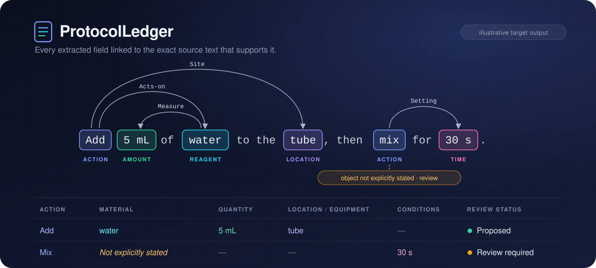
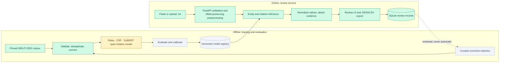
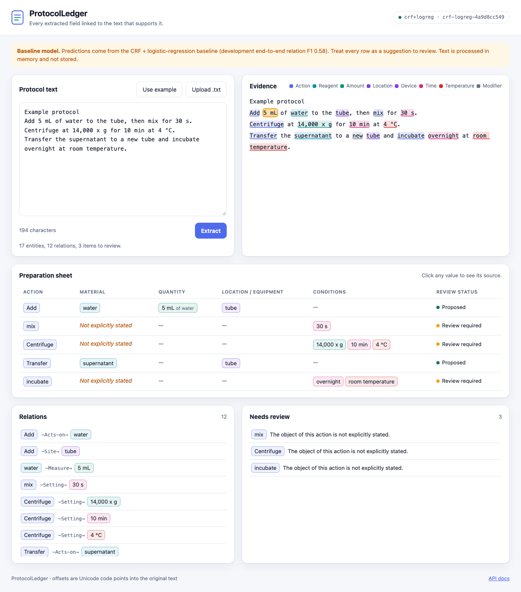

<p align="center">
  
</p>

<p align="center">
  <b>Turn a written lab protocol into a traceable preparation sheet, review uncertain interpretations, and export the corrected result.</b>
</p>

<p align="center">
  <a href="https://github.com/professor3333/ProtocolLedger/actions/workflows/ci.yml"></a>
  <a href="LICENSE"></a>
  
  <a href="https://github.com/astral-sh/ruff"></a>
  
  
</p>

<p align="center">
  <a href="#demo">Demo</a> ·
  <a href="#architecture">Architecture</a> ·
  <a href="#the-problem">The problem</a> ·
  <a href="#review-interface">Interface</a> ·
  <a href="#design-principles">Principles</a> ·
  <a href="#status">Status</a> ·
  <a href="#quickstart">Quickstart</a> ·
  <a href="#data">Data</a> ·
  <a href="#approach">Approach</a> ·
  <a href="#evaluation">Evaluation</a> ·
  <a href="#results">Results</a> ·
  <a href="#deployment">Deployment</a> ·
  <a href="#limitations">Limitations</a> ·
  <a href="#roadmap">Roadmap</a>
</p>

---

ProtocolLedger extracts **actions, materials, quantities, equipment and operating
conditions** from English lab protocols and arranges them into an editable
preparation sheet. Every field links back to the exact characters that support it,
uncertain or implicit interpretations are routed to a human reviewer, and the
reviewed result exports as JSON or CSV with full provenance.

At its core is a **supervised span and directed-relation extraction model** trained
and evaluated in this repository, compared against rule-based and classical
baselines on a deduplicated split of the WNUT-2020 Wet Lab Protocol corpus.

> [!NOTE]
> ProtocolLedger is in early development. The banner shows the **intended** output for
> a worked example, not a prediction from a trained model. See [Status](#status) for
> what exists today.

## Demo

<p align="center">
  
</p>

<sub>40-second recording of the real SciBERT model (no edits to its output before the
reviewer acts), showing a correct extraction, a genuine attachment error, an unresolved
case, the corrections, then save and export.
<a href="docs/assets/demo.mp4">MP4 version</a>.</sub>

## Architecture



<sub>🟩 built · 🟨 in progress · ⬜ planned</sub>

## The problem

Lab instructions pack several actions, materials and measurements into one sentence:

> *Add 5 mL of water to the tube, then mix for 30 s.*

Finding `5 mL`, `water` and `30 s` is only the start. A useful preparation sheet has
to know that **5 mL measures the water**, **water is what gets added**, **the tube is
the destination**, **30 s belongs to mixing**, and that **the object being mixed is
never stated**. Attach a quantity to the wrong material and the sheet is wrong, even
if every individual entity was recognized correctly.

Regular expressions handle familiar quantity patterns but break down on coordination,
unfamiliar reagent names, implicit arguments and competing attachment candidates.
That makes **directed relation extraction** the central technical challenge, and
**reviewable evidence** the central product requirement.

| Who | Uses it to |
|---|---|
| Research assistants and graduate students | build a structured review sheet from an existing protocol |
| Lab managers | see which materials, equipment and conditions are explicitly documented |
| Protocol authors | catch ambiguous wording before sharing |
| Research software developers | consume reviewed JSON through an API |

## Review interface

<p align="center">
  
</p>

The current interface runs the CRF + logistic-regression baseline. Paste or upload
a UTF-8 `.txt` protocol and the page shows:
- the text with every predicted span highlighted
- a preparation sheet in which each value links back to its source characters
- the directed relations
- a review queue

Actions whose object is not stated are shown as *Not explicitly stated*, marked
*Review required*, and never filled in.

**Reviewing.** Select a highlighted span to change its type, move its boundaries word by
word, or reject it. Select any other text to add a missing entity. Add or reject
relations; attaching a quantity to a different material or action replaces its old link.
Reviewer additions are dashed and badged *human*, edits are dotted, and rejections are
struck through but kept in the history. The sheet is recomputed by the server after
every edit, with the same validation that saving uses.

**Saving and exporting.** *Save review* stores a revision (the text only if you tick the
box) and shows a one-time access token. Later saves append revisions. JSON and CSV
exports carry the provenance. Extracted text is processed in memory and is not stored
unless you save a review and opt in.

| Endpoint | Purpose |
|---|---|
| `POST /v1/extract` | entities, relations, preparation-sheet rows, normalized quantities, review items, model version; offsets in Unicode code points |
| `GET /healthz` | process health |
| `GET /readyz` | model loaded; reports model version, bundle hash and dev scores |
| `POST /v1/preview` | validate an edited graph and recompute its sheet, review items and normalized values (stateless) |
| `POST /v1/reviews` | store an explicitly submitted review; returns an id and a one-time token; honors `Idempotency-Key` |
| `POST /v1/reviews/{id}/revisions` | append a corrected revision (token required; text must match the stored hash) |
| `GET /v1/reviews/{id}` | latest revision and full history (token required) |
| `POST /v1/reviews/{id}/export` | reviewed JSON or CSV with provenance; human additions marked |

**Saved reviews:**
- **Storage.** Reviews live in SQLite (WAL mode) and are append-only: every correction is
  a new revision, and database triggers refuse updates and deletes.
- **Text stays private by default.** Protocol text is stored only if the submitter opts
  in; otherwise only its SHA-256 is kept, and reopening or exporting requires the same
  text.
- **Access.** Each review has an unguessable id and a token shown once. Only the token's
  hash is stored. A wrong token and a missing review get the same 404.
- **Provenance.** Every entity and relation records whether it came from the model or a
  person. Model items are accepted, edited (with the original recorded) or rejected;
  human items are added.
- **Exports.** Exports carry the review id, revision, model version and text hash. The
  CSV neutralizes spreadsheet formulas without corrupting values such as `-80 °C`.
- **Backups.** `scripts/backup_reviews.py` takes consistent online backups and restores
  them after an integrity check.

Input is bounded: 256 KB per request, 20,000 characters, 400 lines. Invalid Unicode, NUL
characters and unknown fields are rejected, and error responses never echo submitted text.
The page sends a strict Content-Security-Policy and renders user text only as text.
Model bundles are verified by SHA-256 before anything is deserialized.

### Quantity normalization

Entity types are learned. Turning a quantity into a value is a fixed, tested rule
(`src/protocolledger/values.py`):
- `14,000 x g` → `14000 ×g`
- `5–10 min` → a range
- `~30 min` → 30 min with the qualifier "approximately"
- `-80ºC` → -80 °C
- `RT` → room temperature

Units are canonicalized case-sensitively (`mM` is not `mm`). The entity type resolves
ambiguous units: a bare `g` is grams for an Amount but ×g for a Speed.

Formats outside the supported set are **left as written, not guessed**. Examples are
`4 degrees` (Celsius or Fahrenheit) and `1 x 108`, which lost its superscript from
1×10⁸. The rules normalize 88% of training quantities. Accuracy on an independently
checked sample of supported formats is still to be measured.

## Deployment

One Docker Compose stack on a single CPU host:
- **Caddy** for HTTPS, which also keeps `/metrics` internal
- **the app**, a 134 MB non-root image with read-only model bundles and the SQLite
  review volume
- **Prometheus**

A release pins both the image digest and the model-bundle hash.
`scripts/release.py activate` deploys a release and smoke-tests it, and **restores the
previous release automatically** if the deploy fails. `rollback` restores the previous
image *and* bundle together.

Both paths were rehearsed with real containers, including a review surviving the
rollback. CI builds the image and smoke-tests it with a tiny fixture bundle. See the
[deployment runbook](docs/deployment.md).

## Design principles

- **Evidence first.** Every entity, relation and table cell carries character offsets
  into the original, unmodified text. Clicking a value highlights its source.
- **Never silently fill a gap.** *Not explicitly stated* is a separate state from
  *not required*. Implicit arguments become review items, not guesses.
- **Uncertainty is visible.** Confidence thresholds are calibrated on held-out data,
  and low-confidence or conditional instructions are routed to review.
- **Humans stay distinguishable.** Reviewer additions and corrections are marked
  separately from model output in the interface and in every export.
- **Honest evaluation.** Document-level deduplication, locked test sets, end-to-end
  relation scoring and confidence intervals. Targets are frozen before test results
  are seen, and misses are reported.

## Status

| Component | State |
|---|---|
| Pinned corpus acquisition with per-file hash manifest | ✅ Done |
| BRAT → canonical graph converter and validator | ✅ Done |
| Correction ledger, exact and near-duplicate audit, frozen splits | ✅ Done |
| Rule-based baseline | ✅ Done |
| CRF / logistic-regression baseline | ✅ Done |
| Thin end-to-end review app on the baseline (API, evidence highlighting) | ✅ Done |
| BERT / SciBERT span-and-relation model: code, tests, MLflow tracking | ✅ Done |
| GPU training runs and ablations (Kaggle) | ✅ Done |
| Error taxonomy and slices (unseen names, template siblings) | ✅ Done |
| Precision–coverage and isotonic calibration (baseline and SciBERT) | ✅ Done |
| Verified SciBERT bundle; PyTorch vs ONNX vs INT8 benchmark | ✅ Done |
| Serve SciBERT in the Docker image (released through Compose with smoke test) | ✅ Done |
| Frozen targets; single locked-test evaluation | ✅ Done |
| Correction-batch lifecycle: export, curate, leakage check, retrain, gate, release, rollback (rehearsed) | ✅ Done |
| Challenge set and later-domain protocols.io test set | 🟡 Collected and split; annotation in progress |
| Deterministic quantity normalization | ✅ Done |
| Saved reviews API, JSON/CSV export, backup and restore | ✅ Done |
| Review editing in the interface | ✅ Done |
| Docker / Compose deployment, Prometheus metrics, release + rollback (rehearsed) | ✅ Done |
| Public hosting, CPU optimization (ONNX / INT8), load test | ⬜ Planned |
| User pilot, model card, final report | ⬜ Planned |

## Quickstart

Requires [uv](https://docs.astral.sh/uv/) and Python 3.12.

```bash
git clone https://github.com/professor3333/ProtocolLedger.git
cd ProtocolLedger
uv sync

# Download the corpus at the pinned commit, verify every file hash, extract read-only to data/raw/
uv run python scripts/acquire.py

# Re-check an existing data/raw/ tree against the committed manifest
uv run python scripts/acquire.py --verify

# Convert BRAT annotations into validated canonical graphs (JSONL) and a conversion report
uv run python scripts/convert.py

# Apply the correction ledger, deduplicate, and build the frozen train/dev/test splits
uv run python scripts/build_splits.py

# Score a prediction file with the shared scorer (the test split is locked)
uv run python scripts/evaluate.py --split dev --pred predictions.jsonl --out report.json

# Fit the baselines on train, select their settings on dev, write reports/baselines/
uv run python scripts/run_rules.py
uv run python scripts/run_traditional.py   # CRF + logistic regression, about 5 minutes on CPU

# Build a verified model bundle, then serve the API and review interface
uv run python scripts/build_bundle.py      # refuses unless it reproduces the committed report
PROTOCOLLEDGER_BUNDLE=artifacts/bundles/crf-logreg-4a9d8cc549 PROTOCOLLEDGER_DB=data/reviews.db \
  uv run uvicorn --factory protocolledger.serve.app:create_app_from_env --port 8000
uv run python scripts/backup_reviews.py backup data/reviews.db backups/reviews.db

# SciBERT image (adds CPU PyTorch + transformers); match threads to the host's vCPUs
docker build --build-arg EXTRAS=serve-neural -t protocolledger:neural .
# open http://localhost:8000  (API docs at /docs)

# Neural model (needs the neural extra; a GPU for real runs, CPU for smoke tests)
uv sync --extra neural
uv run python scripts/train_neural.py configs/neural/scibert-lr5e-5.json --seed 13
uv run python scripts/log_reports_mlflow.py    # all committed reports into MLflow
MLFLOW_ALLOW_FILE_STORE=true uvx mlflow ui --backend-store-uri mlruns

# Tests (no network needed) and static checks
uv run pytest -m "not slow"
uv run ruff check && uv run ruff format --check && uv run mypy src/
```

## Data

The corpus is the **WNUT-2020 Wet Lab Protocol corpus**
([jeniyat/WNUT_2020_NER](https://github.com/jeniyat/WNUT_2020_NER)), pinned at commit
[`9a02914`](https://github.com/jeniyat/WNUT_2020_NER/tree/9a02914e00f0a16c0c6820c4285dd72403a5a5a8).
Only the original BRAT standoff directories are used:

| Split | Directory | Released | Entities | Relations¹ | **Cleaned** | Entities | Relations² |
|---|---|---:|---:|---:|---:|---:|---:|
| Train | `data/train_data/Standoff_Format` | 370 | 48,197 | 32,158 | **314** | 40,806 | 27,214 |
| Dev | `data/dev_data/Standoff_Format` | 122 | 15,972 | 10,812 | **112** | 14,936 | 10,065 |
| Test | `data/test_data_2020/Standoff_Format` | 111 | 23,995 | 16,379 | **111** | 23,995 | 16,378 |

<sub>¹ Event arguments plus relation records as released; the converter reproduces
every count and per-label total of the pre-project audit. ² Unique
<code>(head, label, tail)</code> triples after deduplication and corrections. Full
details in the <a href="docs/dataset_card.md">dataset card</a>.</sub>

The cleaned test split is the released `test_data_2020` with only ledger corrections
applied. Cleaned scores are **not directly comparable** with published WNUT-2020
results, which used the splits with duplicates.

The annotations cover **18 entity types** (Action, Reagent, Amount, Location, Device,
Time, Temperature, …) and **14 relation types** (Acts-on, Measure, Setting, Site,
Using, …).

### Conversion

Each protocol becomes one canonical graph: the raw text verbatim, step boundaries,
entities as half-open `[start, end)` character offsets into that text, and directed
relations. Event arguments become `trigger → argument` relations, endpoints that name an
event resolve to its action span, and numbered repeated roles are normalized
(`Acts-on2` → `Acts-on`) with the raw role kept for provenance. Problems are classified
as **errors**, which fail conversion, or **warnings**, which stay on the document and in
the report. Nothing is dropped silently.

### Known data issues

| Finding | Count | Handling |
|---|---:|---|
| Copies and revisions of the same protocol (exact + near-duplicate) | 66 extra documents | one kept per protocol, in the most protected split |
| …crossing train → dev / dev → test | 14 / 1 | training (dev) copy removed; test never reduced |
| Entity spans with leading/trailing whitespace (mostly NBSP) | 291 (202 in test) | trimmed via the correction ledger, all splits |
| Action spans without an event record | 33 | kept, flagged |
| Duplicate relation records | 3 | merged, origins kept |
| Entity pairs with more than one relation label | 2 | kept (multilabel) |
| Stored surface text ≠ offset slice | 1 | offsets authoritative |
| Legacy `test_data/` without relation records | whole folder | not used |

**Duplicate-copy agreement.** Sixteen byte-identical texts were annotated twice in the
release. The two copies agree at **entity F1 0.863** and **relation F1 0.711**, which is
a useful reference for how much any model can agree with a single gold copy.

### Deduplication

Copies are found with whitespace-normalized hashes, and re-segmented copies and
revisions with 5-word-shingle Jaccard similarity. Two documents count as the same
protocol at Jaccard ≥ 0.85, or at ≥ 0.5 with an identical title. Each protocol keeps one
document in the most protected split (test > dev > train). Template siblings, such as
one vendor kit adapted per tissue, are distinct documents. They are kept and recorded so
evaluation can report them as a slice. The rules, threshold evidence and every decision
are in the [dataset card](docs/dataset_card.md) and `data/manifests/dedup_report.json`.

`data/manifests/acquisition.json` records the SHA-256 of every selected file. These
per-file hashes are authoritative. GitHub generates archives on demand, so the archive
hash is recorded, but only a file-level mismatch fails acquisition. Downloaded data is
never committed.

### New annotation sets (protocols.io)

Two new test sets measure how the model does on text it was not built around. Both are
collected from **recent public protocols.io protocols** through the official API, and
neither shares a protocol with WNUT-2020 or with the other set.

| Set | Purpose | Protocols | Steps | Published |
|---|---|---:|---:|---|
| `later-domain` | protocols written about five years after the corpus | 38 (dev 22, test 16) | 301 (dev 173, test 128) | 2025-09 to 2026-08 |
| `challenge` | steps chosen for six hard phenomena | 11 (dev 6, test 5) | 33 (dev 18, test 15) | 2025-10 to 2026-07 |

**Collection** (`scripts/collect_protocolsio.py`, rules in
`src/protocolledger/data/protocolsio.py`):
- **Candidates.** The newest public protocols for ten wet-lab search terms, interleaved
  across terms.
- **Eligibility.** Published on or after 2025-01-01, English, at least 5 usable steps,
  and at least 30% of steps state a quantity. A protocol that is the same as a WNUT-2020
  document (the dedup rule above) or as an earlier candidate is excluded.
- **Step text.** Taken from the API's HTML rendering, so embedded amounts, durations and
  temperatures appear as the reader sees them. Each step is one line. Notes, tables and
  figures are dropped and counted. Steps are usable when they keep 3–120 words, contain
  at least one train-split action word, and are not in an introduction, safety or
  results section.
- **Later-domain set.** The first 8 usable steps of each protocol.
- **Challenge set.** Up to 3 steps per protocol, chosen round-robin until each category
  has at least 10 steps. The categories are multiple actions, repeated materials,
  ranges, unusual symbols, implicit references and conditional wording, each a fixed
  text test using train-only vocabularies.
- **Splits.** Dev or test is assigned per whole protocol from a hash of its id, before
  any annotation. The **test portions are locked** like `test_data_2020`.
- **Reproducibility.** The collected sets are committed in `data/annotation/<set>/`
  (`sources.jsonl` and `texts/`), because protocols.io search results change over time.
  The raw API responses are cached under `data/raw/protocolsio/` (not committed), so
  re-running on the same machine rebuilds byte-identical sets. Every decision is in
  `data/manifests/protocolsio_collection.json`.

Each source keeps its URL, DOI, authors, version and publication date. Protocol text is
protocols.io user content under CC BY, redistributed here with that attribution; the
repository's MIT license covers the code, not this text.

**Annotating.** The gold labels are being written by one annotator from scratch, without
model suggestions. Agreement figures on this data will be **repeat-annotation
consistency**, not inter-annotator agreement.

**Machine labels (provisional).** Until the human gold exists, both sets also have
machine-generated labels that no person has reviewed (`machine_labels.jsonl`, built by
`scripts/build_machine_labels.py`; see the [dataset card](docs/dataset_card.md)). Scores
against them show **agreement with those labels, not accuracy**. Only the dev portions
have been scored:

| Dev portion, vs. machine labels | Entity F1 | Relation F1, end-to-end | Quantity attachment |
|---|---:|---:|---:|
| Later-domain (22 docs), CRF + logistic regression | 0.738 [0.705, 0.776] | 0.560 [0.509, 0.612] | 0.662 (320) |
| Later-domain (22 docs), SciBERT selected (seed 21) | 0.810 [0.783, 0.841] | 0.657 [0.608, 0.705] | 0.778 (320) |
| Challenge (6 docs, 18 steps), CRF + logistic regression | 0.552 [0.495, 0.622] | 0.376 [0.274, 0.487] | 0.410 (39) |
| Challenge (6 docs, 18 steps), SciBERT selected (seed 21) | 0.644 [0.566, 0.742] | 0.529 [0.450, 0.628] | 0.564 (39) |

On the challenge dev steps, SciBERT is weakest on repeated materials (entity F1 0.597, 68
gold entities), ranges (relation F1 0.474, 82 gold relations) and implicit references
(relation F1 0.486, 71). These slices are a few steps each, so the comparison is weak.
Reports: `reports/annotation_sets/*-vs-machine.json`.

```bash
# 1. Collect (needs a protocols.io client access token in ~/.config/protocolledger/protocolsio_token)
uv run python -I scripts/collect_protocolsio.py

# 2. Serve the interface, tick "Annotate from scratch", paste a file from
#    data/annotation/<set>/texts/, label it, and save the review
PROTOCOLLEDGER_BUNDLE=artifacts/bundles/crf-logreg-4a9d8cc549 PROTOCOLLEDGER_DB=data/annotation.db \
  uv run uvicorn --factory protocolledger.serve.app:create_app_from_env --port 8000

# 3. Export the saved annotations as gold, then score a model on the dev portion
uv run python scripts/export_annotations.py --db data/annotation.db --set later-domain
uv run --extra neural python scripts/evaluate_annotation_set.py --set later-domain \
  --split dev --bundle artifacts/bundles/scibert-uniform-negatives-s21-7dc7a1893e
```

## Approach

Three systems, evaluated on the same splits with the same scorer:

| System | Entities | Relations | Purpose |
|---|---|---|---|
| Rules | unit regexes, action vocabulary, training-derived material dictionary | nearest compatible span in the clause | what inexpensive rules achieve |
| Traditional | linear-chain CRF with lexical and character features | logistic classifiers on types, distance, intervening words | a strong supervised baseline |
| Neural | span classification over a shared transformer encoder | span-pair classification, multilabel | contextual boundaries and attachments |

The neural model (`src/protocolledger/neural/`) follows a SpERT-style design:
1. Encode each protocol step once.
2. Score every candidate span of up to 10 words. That covers 99.92% of training
   entities; the rest are counted as unreachable.
3. Classify directed, multilabel relations between the retained spans.

A span is the max-pool of its words plus a width embedding. A pair adds the max-pooled
words between the two spans, the two entity types and a signed distance bucket, which
can be switched off for ablation. Range max-pooling uses a sparse table, so no per-pair
masks are materialized. Training samples hard negatives: spans touching gold spans, and
pairs that share an endpoint with a gold relation. Checkpoints are selected on dev
**end-to-end** relation F1 with predicted entities, and interrupted runs resume exactly
from `last.pt`.

SciBERT (`scibert_scivocab_cased`) is compared against `bert-base-cased` as a control,
both pinned to exact Hugging Face commits, so whether scientific pretraining helps is
measured, not assumed. Two tokenizer pitfalls are handled explicitly:
- SciBERT's cased checkpoint ships without a tokenizer config and would silently
  lowercase (`mM` → `mm`), so case preservation is forced and checked at load time.
- Characters missing from the vocabularies, such as the micro sign in `µL` (1,971
  occurrences, `[UNK]` in SciBERT), are substituted only in the encoder's view.
  Offsets always come from the original text.

## Evaluation

| Metric | What it establishes |
|---|---|
| Strict entity micro-F1 | exact boundaries and types |
| Relation F1 with gold entities | the relation classifier in isolation |
| **End-to-end relation F1** | correct type, direction, both endpoint spans and types |
| Quantity attachment accuracy | each value belongs to the right material or action |
| Complete-step exact match | how often a step needs no correction at all |
| Normalized-value exact match | numeric value, unit, range or symbolic value |
| Precision vs. coverage | reliability of retained predictions as thresholds change |

One scorer (`src/protocolledger/eval/scorer.py`) produces every reported number, for
every system. It reports per-label scores with support, macro-F1 over supported labels,
and document-level bootstrap confidence intervals. Duplicate predictions are collapsed.
The locked test split can only be scored for a declared release. Planned slices: unseen
reagent names, Unicode perturbations, template siblings, a challenge set and recently
published protocols.

## Results

### Locked test (evaluated once, 2026-10-11)

The targets were frozen in [docs/targets.md](docs/targets.md) and merged first. The
declared releases were then evaluated **once** on the cleaned `test_data_2020` (111
protocols) by `scripts/locked_test.py`, at commit `fe0297c`
([full report](reports/test/locked-test.md)).

| System | Entity F1 | Relation F1, gold entities | **Relation F1, end-to-end** | Quantity attachment |
|---|---:|---:|---:|---:|
| Rules | 0.647 [0.624, 0.668] | 0.575 | 0.292 [0.270, 0.317] | 0.441 |
| CRF + logistic regression | 0.703 [0.677, 0.727] | 0.768 | 0.504 [0.473, 0.536] | 0.629 |
| **SciBERT span-relation** | **0.766** [0.748, 0.784] | **0.787** | **0.580** [0.552, 0.606] | **0.699** |

| Frozen target | Test result | Met |
|---|---|---|
| Strict entity micro-F1 ≥ 0.75 | 0.766 | yes |
| End-to-end relation micro-F1 ≥ 0.65 | 0.580 | **no** |
| ≥ 5 points above the traditional baseline | +7.6 points | yes |
| ≥ 95% relation precision at ≥ 30% coverage | 95% precision at 13.4% coverage | **no** |
| ≤ 5-point F1 loss under whitespace / Unicode perturbations | −0.01 points | yes |
| Optimized artifact ≤ 1-point F1 loss (dev) | ONNX INT8 −0.28 | yes |
| p95 ≤ 3 s, ≥ 99% success, ≤ 3 GB (container, 4 CPUs) | 2.40 s, 100%, 1.06 GB | yes |
| Normalization ≥ 98% exact match, independently checked set | no independent set | not evaluated |
| ≥ 25% faster sheet completion (user pilot) | no pilot run | not evaluated |

Test is harder than dev for every system: CRF + logistic regression falls from 0.582 to
0.504, and SciBERT from 0.639 to 0.580. SciBERT's margin over the traditional baseline
grows on test, from +5.7 to +7.6 points. Its largest advantage is on reagent names never
seen in training: recall 0.762 against 0.631. The dev-fitted isotonic calibrator transfers
to test, reducing expected calibration error from 0.172 to 0.021. The two relation-quality
targets are missed; the misses are reported here and the targets were not changed.

### Development set

> [!NOTE]
> The results below are **development-set** results, used to build, select and compare
> systems before the single test evaluation above.

| System (dev, 112 documents) | Entity F1 | Relation F1, gold entities | **Relation F1, end-to-end** | Quantity attachment | Complete steps |
|---|---:|---:|---:|---:|---:|
| Rules | 0.692 [0.666, 0.715] | 0.604 [0.577, 0.633] | **0.355** [0.322, 0.386] | 0.521 | 0.112 |
| CRF + logistic regression | 0.756 [0.733, 0.779] | 0.812 [0.795, 0.829] | **0.582** [0.553, 0.611] | 0.708 | 0.231 |
| **SciBERT span-relation, selected** (uniform negatives, 3 seeds) | **0.800** | 0.826 | **0.640 ± 0.004** | 0.758 | — |
| SciBERT span-relation, hard negatives (3 seeds) | 0.802 | 0.822 | 0.636 ± 0.006 | 0.768 | — |
| BERT-base-cased control (1 seed) | 0.795 | 0.821 | 0.634 [0.611, 0.657] | 0.764 | — |

<sub>Strict matching; 95% document-level bootstrap intervals in brackets for single runs,
mean ± sd over seeds otherwise. All experiments, including ablations:
<a href="reports/experiments-dev.md">reports/experiments-dev.md</a>. Full per-label
tables: <a href="reports/baselines/rules-dev.md">rules</a>,
<a href="reports/baselines/crf-logreg-dev.md">CRF + logistic regression</a>,
<a href="reports/neural/scibert-lr2e-5-s13-dev.md">SciBERT</a>.</sub>

**What the experiments answer** (dev):

| Question from the plan | Answer |
|---|---|
| Rules → CRF: does supervision help? | Yes: relation F1 0.355 → 0.582 |
| CRF → SciBERT: does a contextual encoder help? | Yes: 0.582 → 0.640 ± 0.004 (3 seeds), entity F1 0.756 → 0.800 |
| BERT → SciBERT: does scientific pretraining help? | Barely: 0.634 vs 0.641 at the same settings, well within noise |
| Frozen → fine-tuned encoder: worth the compute? | Decisively: 0.487 frozen vs 0.641 fine-tuned |
| Uniform → hard negatives: are hard attachments learned better? | No: uniform 0.640 ± 0.004 vs hard 0.636 ± 0.006 (3 seeds each) |
| Remove type and distance features | Small end-to-end cost (−0.7), but −3.8 points given gold entities |

**Targets are frozen** in [docs/targets.md](docs/targets.md), unchanged from the plan and
committed before the locked test split was touched.

**Selected configuration:** SciBERT, lr 2e-5, uniform negatives, the highest 3-seed dev
mean. The served model is its **median** seed (21), not the best, to avoid an optimistic
pick.

Against the proposed targets, the selected configuration clears **entity F1 ≥ 0.75** and
is **≥ 5 points above the traditional baseline** (+5.8 on the 3-seed mean). It does
**not** reach end-to-end relation F1 ≥ 0.65 on dev (0.640 ± 0.004). The targets are not frozen yet, and this result
will be reported as it stands rather than adjusted.

- **Supervision pays off.** The CRF + logistic-regression baseline raises end-to-end
  relation F1 from 0.355 to 0.582. Most of the gain is in attachment: given the same gold
  entities, relation F1 rises from 0.604 to 0.812.
- **Entity errors compound.** Even with relation F1 0.812 on gold entities, end-to-end F1
  is 0.582. Every missed or mis-bounded entity also breaks the relations that touch it.
- **Quantities are easy; open vocabulary is not.** Temperature, Speed and Time exceed 0.91
  entity F1, while Method (0.46), Modifier (0.53) and Device (0.58) lag. Rare relations
  such as Commands (37 dev instances) and Of-Type (26) score 0.
- **Reference point.** Duplicate copies of the same protocol in the corpus agree with
  each other at relation F1 0.711.

**Where SciBERT's gains come from** (served model vs CRF + logistic regression, dev;
[error report](reports/errors/scibert-uniform-s21-dev.md)):

| | CRF + LR | SciBERT |
|---|---:|---:|
| Gold relations correct | 54.5% | **62.7%** |
| Failed through an endpoint entity error | 34.4% | 27.7% |
| Genuine attachment errors | 3.0% | 2.9% |
| Reagent recall, names **unseen** in training | 0.570 | **0.658** |
| Relation recall, documents **without** a template sibling | 0.524 | **0.613** |

The gains are largest where generalization matters: unseen names, and documents that
share no template with training.

**Confidence** (served model, joint score P(relation) × P(head) × P(tail);
[report](reports/calibration/scibert-uniform-s21-joint-dev.md)):
- **Precision:** 0.920 at 30% coverage. 95% precision is reachable only at 18.7%
  coverage, so the target of 95% precision at ≥ 30% coverage is **not met**.
- **Calibration:** isotonic calibration brings the expected calibration error from 0.183
  to 0.009.

**Baseline error analysis** (CRF + logistic regression, dev; [full report with
examples](reports/errors/crf-logreg-dev.md)):

| Gold relations (10,065) | Share |
|---|---:|
| correct | 54.5% |
| **endpoint entity wrong** (entity error cascading) | **34.4%** |
| missed (endpoints right, no relation) | 5.6% |
| wrong attachment (same label, wrong head or tail) | 3.0% |
| wrong label | 2.5% |
| wrong direction | 0.1% |

About three of every four relation errors start as entity errors, so better entity
boundaries are where a contextual encoder has the most to gain.

Two slices stand out:
- **Unseen reagent names.** Reagent names never seen in training are found with recall
  **0.570**, against **0.873** for seen names. This is the slice where scientific
  pretraining should help.
- **Template siblings.** Dev documents that share a vendor template with a training
  document get relation recall 0.719, against 0.524 without, which is why template
  siblings are reported separately.

**Confidence** (CRF + logistic regression, dev; [report](reports/calibration/crf-logreg-dev.md)):
- **Raw relation scores are badly calibrated.** Expected calibration error (ECE) is
  0.214. Isotonic regression, cross-fitted by document on dev, brings it to 0.009.
- **The baseline's confidence can't support the 95%-precision target.** Its most
  confident relations reach about 85% precision (0.808 at 30% coverage), because a
  relation score cannot see whether its endpoint entities are right. The neural model
  will also be scored with a joint confidence, P(relation) × P(head) × P(tail).

### Serving performance

| System | Machine | p95 latency | Success (1,000 requests) | Peak memory |
|---|---|---:|---:|---:|
| CRF + logistic regression | Apple M1 host, Docker limited to 4 CPUs / 4 GB | 0.035 s | 100% | 125 MiB |
| **SciBERT, PyTorch FP32 (served)**, container | Apple M1 host, Docker limited to 4 CPUs / 4 GB, `PROTOCOLLEDGER_THREADS=4` | **2.40 s** | 100% | 1,058 MiB |
| SciBERT, same container, default threads | same, threads not matched to the CPU quota | 3.90 s | 100% | 1,064 MiB |
| SciBERT, PyTorch FP32, in-process | Apple M1 (8 GB), 4 inference threads | 2.07 s | — | 938 MiB |
| SciBERT, ONNX Runtime FP32 | same | 6.94 s | — | 1,058 MiB |
| SciBERT, ONNX Runtime INT8 (−0.28 F1) | same | 2.90 s | — | 918 MiB |

<sub>Concurrency 1, dev protocols of up to 500 words, after warm-up
(<a href="reports/performance/crf-logreg-m1-4cpu.md">report</a>, <code>scripts/load_test.py</code>).
Targets: p95 ≤ 3 s, ≥ 99% success, ≤ 3 GB. SciBERT runtimes:
<a href="reports/performance/scibert-uniform-negatives-s21-7dc7a1893e-runtimes.md">report</a>.
On this ARM machine ONNX Runtime is slower than PyTorch, so PyTorch FP32 is served.
Matching inference threads to the container's CPU quota matters: with PyTorch's default
(one thread per host core) the CPU-limited container missed the p95 target (3.90 s).
Re-measure on the deployment host before changing runtimes.</sub>

## Limitations

**Data.**
- All protocols come from one source (protocols.io), annotated in or before 2020, and
  cover a limited range of wet-lab subdomains. There is no claim about other sources or
  newer protocols until the later-domain test set is annotated and scored.
- Exact and near-duplicate copies were removed, but protocols built from shared vendor
  templates remain. Documents with a template sibling in training score higher, which is
  why they are reported as a separate slice.
- The annotations are themselves inconsistent: duplicate copies of the same protocol
  agree at relation F1 0.711. That bounds what any model can score against a single gold
  copy.

**Model.**
- **Misses two frozen targets on the locked test.** End-to-end relation F1 is 0.580
  against a target of 0.65, and 95% precision is reachable only at 13.4% coverage
  against a target of 30%.
- **Most relation errors start as entity errors.** Open-vocabulary types (Method,
  Modifier, Device) and rare relations (Commands, Of-Type, Product) are weakest.
- **Not modelled:** implicit references ("it"), cross-step coreference, negation,
  alternatives and conditional instructions. The interface routes unstated objects to
  review rather than guessing, but it does not detect every implicit argument.
- **Input scope:** English, plain text only (no PDF or OCR). Words glued together by
  table flattening (`100 µlof`) cannot be segmented.

**Evaluation.**
- Value normalization has not been checked against an independently labelled set.
- The challenge and later-domain sets are collected but not yet annotated, so there are
  no results on them yet.
- **No user pilot has been run**, so there is no evidence yet that the tool saves time.
- Latency and memory were measured on an Apple M1 with Docker limited to 4 CPUs, not on
  a production x86 host.

**Product.**
- **Not publicly hosted yet.** The local Docker path is complete.
- Reviews are protected by unguessable ids and one-time tokens, not by user accounts.
- One process with SQLite is the intended scale. Concurrent multi-user load is untested.
- **Not for executing protocols, or for judging whether a protocol is complete, correct
  or safe.** Every row is a suggestion for a person to review.

## Roadmap

- [x] **Phase 0:** project skeleton, CI, pinned corpus acquisition
- [x] **Phase 1:** annotation converter, validation, duplicate audit, frozen splits
- [ ] **Phase 2:** rule-based and CRF / logistic baselines, thin end-to-end app
- [x] **Phase 3:** BERT / SciBERT span-and-relation model with ablations
- [ ] **Phase 4:** error analysis, calibration, fresh annotations and challenge set
- [ ] **Phase 5:** API, evidence highlighting, editing, saved reviews, exports
- [ ] **Phase 6:** CPU optimization, Docker deployment, monitoring and rollback
- [ ] **Phase 7:** user pilot, model and data cards, final report

## Project structure

```text
ProtocolLedger/
├── data/manifests/
│   ├── acquisition.json         # per-file SHA-256 of the pinned corpus
│   ├── conversion_report.json   # counts, labels, issues, output hashes
│   ├── corrections.jsonl        # correction ledger (before/after for every change)
│   ├── dedup_report.json        # duplicate evidence and duplicate-copy agreement
│   └── splits.json              # frozen train/dev/test document lists and hashes
├── deploy/                # compose.yaml, Caddyfile, prometheus.yml
├── Dockerfile             # pinned base images, non-root, code + deps only
├── docs/
│   ├── model_card.md      # intended use, limits, provenance, metrics, failure modes
│   ├── targets.md         # acceptance targets, frozen before the locked test evaluation
│   ├── deployment.md      # runbook: releases, rollback, backups, monitoring
│   ├── assets/            # README artwork and interface screenshot
│   └── dataset_card.md    # sources, conversion, corrections, deduplication, splits
├── reports/baselines/     # committed dev reports (JSON + Markdown)
├── reports/errors/        # error taxonomy and slices per system (dev)
├── reports/calibration/   # precision–coverage and calibration per system (dev)
├── reports/performance/   # load-test results with the hardware named
├── scripts/
│   ├── acquire.py         # fetch and verify the pinned corpus
│   ├── convert.py         # BRAT → canonical JSONL graphs + conversion report
│   ├── build_splits.py    # correction ledger, deduplication, frozen splits
│   ├── evaluate.py        # score predictions with the shared scorer
│   ├── run_rules.py       # fit / select / report the rule-based baseline
│   ├── run_traditional.py # fit / select / report CRF + logistic regression
│   ├── build_bundle.py    # verified, versioned model bundle for serving
│   ├── train_neural.py    # train / select / report one neural configuration
│   ├── kaggle.py          # launch / monitor / fetch GPU jobs on Kaggle
│   ├── export_review_batch.py # saved reviews → correction batch awaiting curation
│   ├── train_candidate.py # curated batch → leakage check → retrain → dev gate → candidate
│   ├── backup_reviews.py  # consistent backup / verified restore of the review database
│   ├── log_reports_mlflow.py  # committed reports into MLflow (idempotent)
│   ├── release.py         # activate / rollback / status (image + bundle pinned together)
│   ├── smoke_test.py      # post-deploy end-to-end check (stdlib only)
│   ├── load_test.py       # latency / reliability / memory load test against a container
│   └── make_fixture_bundle.py # tiny bundle for CI container smoke tests
├── src/protocolledger/baselines/
│   ├── rules.py           # unit patterns, training dictionary, nearest-span relations
│   ├── crf_entities.py    # linear-chain CRF tagger (BIO, lexical + character features)
│   └── logreg_relations.py # pair classifier: types, distance, words between, punctuation
├── src/protocolledger/text/
│   ├── tokenize.py        # offset-preserving tokenizer
│   └── normalize.py       # encoder-view character substitutions (offsets untouched)
├── src/protocolledger/values.py  # deterministic quantity normalization
├── configs/neural/        # one JSON per experiment (encoder, learning rate, ablations)
├── src/protocolledger/neural/
│   ├── encoding.py        # steps → word examples, coverage accounting
│   ├── model.py           # span + relation heads, sparse-table pooling
│   ├── batching.py        # subword alignment, hard-negative sampling
│   ├── predict.py         # decoding back to raw-text offsets
│   ├── train.py           # AMP training, early stopping, resumable checkpoints
│   └── tracking.py        # MLflow file-store tracking
├── src/protocolledger/serve/
│   ├── app.py             # FastAPI: /v1/extract, /healthz, /readyz, review page
│   ├── bundle.py          # hash-verified model bundles
│   ├── reviews.py         # append-only SQLite review store (WAL, token-gated)
│   ├── export.py          # review validation, JSON / CSV export with provenance
│   ├── schemas.py         # versioned request / response schemas
│   ├── sheet.py           # graph → preparation-sheet rows and review items
│   └── static/            # HTML / CSS / JS review interface (no build step)
├── src/protocolledger/eval/
│   ├── scorer.py          # strict entity, end-to-end relation, attachment, step metrics
│   ├── errors.py          # error taxonomy, slices, examples
│   └── confidence.py      # precision–coverage, ECE, cross-fitted isotonic calibration
├── src/protocolledger/data/
│   ├── acquire.py         # download, safe extraction, manifest verification
│   ├── brat.py            # strict BRAT standoff parser
│   ├── convert.py         # event resolution, validation, canonical graphs
│   ├── corrections.py     # correction ledger rules and application
│   ├── dedup.py           # exact / near-duplicate detection, split resolution
│   ├── splits.py          # hash-verified loading of the frozen splits
│   └── schema.py          # 18 entity labels, 14 relation labels, role normalization
└── tests/                 # unit tests (no network)
```

## References

- J. Tabassum, W. Xu, A. Ritter. [WNUT-2020 Task 1 Overview: Extracting Entities and Relations from Wet Lab Protocols](https://aclanthology.org/2020.wnut-1.33/). W-NUT 2020.
- R. Tamari, F. Bai, A. Ritter, G. Stanovsky. [Process-Level Representation of Scientific Protocols with Interactive Annotation](https://aclanthology.org/2021.eacl-main.187/). EACL 2021.
- M. Eberts, A. Ulges. [Span-based Joint Entity and Relation Extraction with Transformer Pre-training](https://arxiv.org/abs/1909.07755). ECAI 2020.
- I. Beltagy, K. Lo, A. Cohan. [SciBERT: A Pretrained Language Model for Scientific Text](https://aclanthology.org/D19-1371/). EMNLP 2019.

## License

The code in this repository is released under the [MIT License](LICENSE).

The WNUT-2020 corpus is distributed by its authors under the MIT License. The protocol
texts originate from [protocols.io](https://www.protocols.io), where user content is
published under [CC BY](https://www.protocols.io/terms). Keep the corpus notice and
per-protocol attribution when redistributing protocol text.
