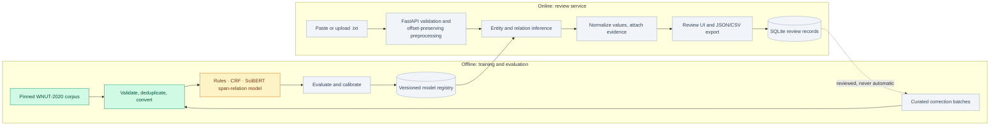

<p align="center">
  
</p>

<p align="center">
  <b>Turn a written lab protocol into a traceable preparation sheet, review uncertain interpretations, and export the corrected result.</b>
</p>

<p align="center">
  <a href="https://github.com/professor3333/ProtocolLedger/actions/workflows/ci.yml"></a>
  <a href="LICENSE"></a>
  
  <a href="https://github.com/astral-sh/ruff"></a>
  
  
</p>

<p align="center">
  <a href="#architecture">Architecture</a> ·
  <a href="#the-problem">The problem</a> ·
  <a href="#design-principles">Principles</a> ·
  <a href="#status">Status</a> ·
  <a href="#quickstart">Quickstart</a> ·
  <a href="#data">Data</a> ·
  <a href="#approach">Approach</a> ·
  <a href="#evaluation">Evaluation</a> ·
  <a href="#roadmap">Roadmap</a>
</p>

---

ProtocolLedger extracts **actions, materials, quantities, equipment and operating
conditions** from English lab protocols and arranges them into an editable
preparation sheet. Every field links back to the exact characters that support it,
uncertain or implicit interpretations are routed to a human reviewer, and the
reviewed result exports as JSON or CSV with full provenance.

At its core is a **supervised span and directed-relation extraction model** trained
and evaluated in this repository, compared against rule-based and classical
baselines on a deduplicated split of the WNUT-2020 Wet Lab Protocol corpus.

> [!NOTE]
> ProtocolLedger is in early development. The banner shows the **intended** output for
> a worked example, not a prediction from a trained model. See [Status](#status) for
> what exists today.

## Architecture



<sub>🟩 built · 🟨 in progress · ⬜ planned</sub>

## The problem

Lab instructions pack several actions, materials and measurements into one sentence:

> *Add 5 mL of water to the tube, then mix for 30 s.*

Finding `5 mL`, `water` and `30 s` is only the start. A useful preparation sheet has
to know that **5 mL measures the water**, **water is what gets added**, **the tube is
the destination**, **30 s belongs to mixing**, and that **the object being mixed is
never stated**. Attach a quantity to the wrong material and the sheet is wrong, even
if every individual entity was recognized correctly.

Regular expressions handle familiar quantity patterns but break down on coordination,
unfamiliar reagent names, implicit arguments and competing attachment candidates.
That makes **directed relation extraction** the central technical challenge, and
**reviewable evidence** the central product requirement.

| Who | Uses it to |
|---|---|
| Research assistants and graduate students | build a structured review sheet from an existing protocol |
| Lab managers | see which materials, equipment and conditions are explicitly documented |
| Protocol authors | catch ambiguous wording before sharing |
| Research software developers | consume reviewed JSON through an API |

## Design principles

- **Evidence first.** Every entity, relation and table cell carries character offsets
  into the original, unmodified text. Clicking a value highlights its source.
- **Never silently fill a gap.** *Not explicitly stated* is a separate state from
  *not required*. Implicit arguments become review items, not guesses.
- **Uncertainty is visible.** Confidence thresholds are calibrated on held-out data,
  and low-confidence or conditional instructions are routed to review.
- **Humans stay distinguishable.** Reviewer additions and corrections are marked
  separately from model output in the interface and in every export.
- **Honest evaluation.** Document-level deduplication, locked test sets, end-to-end
  relation scoring and confidence intervals. Targets are frozen before test results
  are seen, and misses are reported.

## Status

| Component | State |
|---|---|
| Pinned corpus acquisition with per-file hash manifest | ✅ Done |
| BRAT → canonical graph converter and validator | ✅ Done |
| Correction ledger, exact and near-duplicate audit, frozen splits | ✅ Done |
| Rule-based and CRF / logistic-regression baselines | 🚧 Next |
| BERT / SciBERT span-and-relation model | ⬜ Planned |
| Calibration, error analysis, challenge set | ⬜ Planned |
| FastAPI service, review interface, exports | ⬜ Planned |
| CPU optimization, Docker deployment, monitoring | ⬜ Planned |
| User pilot, model card, final report | ⬜ Planned |

## Quickstart

Requires [uv](https://docs.astral.sh/uv/) and Python 3.12.

```bash
git clone https://github.com/professor3333/ProtocolLedger.git
cd ProtocolLedger
uv sync

# Download the corpus at the pinned commit, verify every file hash, extract read-only to data/raw/
uv run python scripts/acquire.py

# Re-check an existing data/raw/ tree against the committed manifest
uv run python scripts/acquire.py --verify

# Convert BRAT annotations into validated canonical graphs (JSONL) and a conversion report
uv run python scripts/convert.py

# Apply the correction ledger, deduplicate, and build the frozen train/dev/test splits
uv run python scripts/build_splits.py

# Score a prediction file with the shared scorer (the test split is locked)
uv run python scripts/evaluate.py --split dev --pred predictions.jsonl --out report.json

# Tests (no network needed) and static checks
uv run pytest -m "not slow"
uv run ruff check && uv run ruff format --check && uv run mypy src/
```

## Data

The corpus is the **WNUT-2020 Wet Lab Protocol corpus**
([jeniyat/WNUT_2020_NER](https://github.com/jeniyat/WNUT_2020_NER)), pinned at commit
[`9a02914`](https://github.com/jeniyat/WNUT_2020_NER/tree/9a02914e00f0a16c0c6820c4285dd72403a5a5a8).
Only the original BRAT standoff directories are used:

| Split | Directory | Released | Entities | Relations¹ | **Cleaned** | Entities | Relations² |
|---|---|---:|---:|---:|---:|---:|---:|
| Train | `data/train_data/Standoff_Format` | 370 | 48,197 | 32,158 | **314** | 40,806 | 27,214 |
| Dev | `data/dev_data/Standoff_Format` | 122 | 15,972 | 10,812 | **112** | 14,936 | 10,065 |
| Test | `data/test_data_2020/Standoff_Format` | 111 | 23,995 | 16,379 | **111** | 23,995 | 16,378 |

<sub>¹ Event arguments plus relation records as released; the converter reproduces
every count and per-label total of the pre-project audit. ² Unique
<code>(head, label, tail)</code> triples after deduplication and corrections. Full
details in the <a href="docs/dataset_card.md">dataset card</a>.</sub>

The cleaned test split is the released `test_data_2020` with only ledger corrections
applied. Cleaned scores are **not directly comparable** with published WNUT-2020
results, which used the splits with duplicates.

The annotations cover **18 entity types** (Action, Reagent, Amount, Location, Device,
Time, Temperature, …) and **14 relation types** (Acts-on, Measure, Setting, Site,
Using, …).

### Conversion

Each protocol becomes one canonical graph: the raw text verbatim, step boundaries,
entities as half-open `[start, end)` character offsets into that text, and directed
relations. Event arguments become `trigger → argument` relations, endpoints that name an
event resolve to its action span, and numbered repeated roles are normalized
(`Acts-on2` → `Acts-on`) with the raw role kept for provenance. Problems are classified
as **errors**, which fail conversion, or **warnings**, which stay on the document and in
the report. Nothing is dropped silently.

### Known data issues

| Finding | Count | Handling |
|---|---:|---|
| Copies and revisions of the same protocol (exact + near-duplicate) | 66 extra documents | one kept per protocol, in the most protected split |
| …crossing train → dev / dev → test | 14 / 1 | training (dev) copy removed; test never reduced |
| Entity spans with leading/trailing whitespace (mostly NBSP) | 291 (202 in test) | trimmed via the correction ledger, all splits |
| Action spans without an event record | 33 | kept, flagged |
| Duplicate relation records | 3 | merged, origins kept |
| Entity pairs with more than one relation label | 2 | kept (multilabel) |
| Stored surface text ≠ offset slice | 1 | offsets authoritative |
| Legacy `test_data/` without relation records | whole folder | not used |

**Duplicate-copy agreement.** Sixteen byte-identical texts were annotated twice in the
release. The two copies agree at **entity F1 0.863** and **relation F1 0.711**, which is
a useful reference for how much any model can agree with a single gold copy.

### Deduplication

Copies are found with whitespace-normalized hashes, and re-segmented copies and
revisions with 5-word-shingle Jaccard similarity. Two documents count as the same
protocol at Jaccard ≥ 0.85, or at ≥ 0.5 with an identical title. Each protocol keeps one
document in the most protected split (test > dev > train). Template siblings, such as
one vendor kit adapted per tissue, are distinct documents. They are kept and recorded so
evaluation can report them as a slice. The rules, threshold evidence and every decision
are in the [dataset card](docs/dataset_card.md) and `data/manifests/dedup_report.json`.

`data/manifests/acquisition.json` records the SHA-256 of every selected file. These
per-file hashes are authoritative. GitHub generates archives on demand, so the archive
hash is recorded, but only a file-level mismatch fails acquisition. Downloaded data is
never committed.

## Approach

Three systems, evaluated on the same splits with the same scorer:

| System | Entities | Relations | Purpose |
|---|---|---|---|
| Rules | unit regexes, action vocabulary, training-derived material dictionary | nearest compatible span in the clause | what inexpensive rules achieve |
| Traditional | linear-chain CRF with lexical and character features | logistic classifiers on types, distance, intervening words | a strong supervised baseline |
| Neural | span classification over a shared transformer encoder | span-pair classification, multilabel | contextual boundaries and attachments |

The neural model follows a SpERT-style design: encode a sentence once, classify
candidate spans, then classify relations between retained spans. SciBERT
(`scibert_scivocab_cased`) is compared against `bert-base-cased` as a control, so
whether scientific pretraining helps is measured, not assumed.

## Evaluation

| Metric | What it establishes |
|---|---|
| Strict entity micro-F1 | exact boundaries and types |
| Relation F1 with gold entities | the relation classifier in isolation |
| **End-to-end relation F1** | correct type, direction, both endpoint spans and types |
| Quantity attachment accuracy | each value belongs to the right material or action |
| Complete-step exact match | how often a step needs no correction at all |
| Normalized-value exact match | numeric value, unit, range or symbolic value |
| Precision vs. coverage | reliability of retained predictions as thresholds change |

One scorer (`src/protocolledger/eval/scorer.py`) produces every reported number, for
every system. It reports per-label scores with support, macro-F1 over supported labels,
and document-level bootstrap confidence intervals. Duplicate predictions are collapsed.
The locked test split can only be scored for a declared release. Planned slices: unseen
reagent names, Unicode perturbations, template siblings, a challenge set and recently
published protocols.

## Roadmap

- [x] **Phase 0:** project skeleton, CI, pinned corpus acquisition
- [x] **Phase 1:** annotation converter, validation, duplicate audit, frozen splits
- [ ] **Phase 2:** rule-based and CRF / logistic baselines, thin end-to-end app
- [ ] **Phase 3:** BERT / SciBERT span-and-relation model with ablations
- [ ] **Phase 4:** error analysis, calibration, fresh annotations and challenge set
- [ ] **Phase 5:** API, evidence highlighting, editing, saved reviews, exports
- [ ] **Phase 6:** CPU optimization, Docker deployment, monitoring and rollback
- [ ] **Phase 7:** user pilot, model and data cards, final report

## Project structure

```text
ProtocolLedger/
├── data/manifests/
│   ├── acquisition.json         # per-file SHA-256 of the pinned corpus
│   ├── conversion_report.json   # counts, labels, issues, output hashes
│   ├── corrections.jsonl        # correction ledger (before/after for every change)
│   ├── dedup_report.json        # duplicate evidence and duplicate-copy agreement
│   └── splits.json              # frozen train/dev/test document lists and hashes
├── docs/
│   ├── assets/            # README artwork
│   └── dataset_card.md    # sources, conversion, corrections, deduplication, splits
├── scripts/
│   ├── acquire.py         # fetch and verify the pinned corpus
│   ├── convert.py         # BRAT → canonical JSONL graphs + conversion report
│   ├── build_splits.py    # correction ledger, deduplication, frozen splits
│   └── evaluate.py        # score predictions with the shared scorer
├── src/protocolledger/eval/
│   └── scorer.py          # strict entity, end-to-end relation, attachment, step metrics
├── src/protocolledger/data/
│   ├── acquire.py         # download, safe extraction, manifest verification
│   ├── brat.py            # strict BRAT standoff parser
│   ├── convert.py         # event resolution, validation, canonical graphs
│   ├── corrections.py     # correction ledger rules and application
│   ├── dedup.py           # exact / near-duplicate detection, split resolution
│   ├── splits.py          # hash-verified loading of the frozen splits
│   └── schema.py          # 18 entity labels, 14 relation labels, role normalization
└── tests/                 # unit tests (no network)
```

## References

- J. Tabassum, W. Xu, A. Ritter. [WNUT-2020 Task 1 Overview: Extracting Entities and Relations from Wet Lab Protocols](https://aclanthology.org/2020.wnut-1.33/). W-NUT 2020.
- R. Tamari, F. Bai, A. Ritter, G. Stanovsky. [Process-Level Representation of Scientific Protocols with Interactive Annotation](https://aclanthology.org/2021.eacl-main.187/). EACL 2021.
- M. Eberts, A. Ulges. [Span-based Joint Entity and Relation Extraction with Transformer Pre-training](https://arxiv.org/abs/1909.07755). ECAI 2020.
- I. Beltagy, K. Lo, A. Cohan. [SciBERT: A Pretrained Language Model for Scientific Text](https://aclanthology.org/D19-1371/). EMNLP 2019.

## License

The code in this repository is released under the [MIT License](LICENSE).

The WNUT-2020 corpus is distributed by its authors under the MIT License. The protocol
texts originate from [protocols.io](https://www.protocols.io), where user content is
published under [CC BY](https://www.protocols.io/terms). Keep the corpus notice and
per-protocol attribution when redistributing protocol text.
