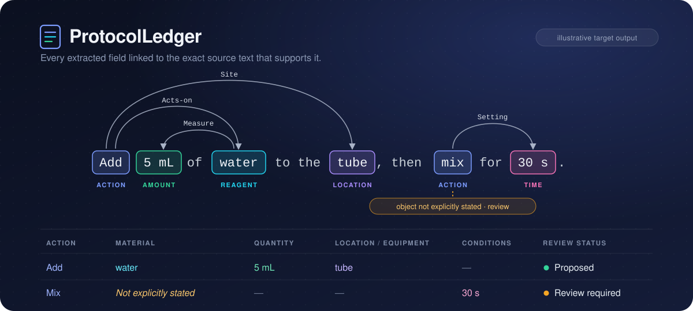
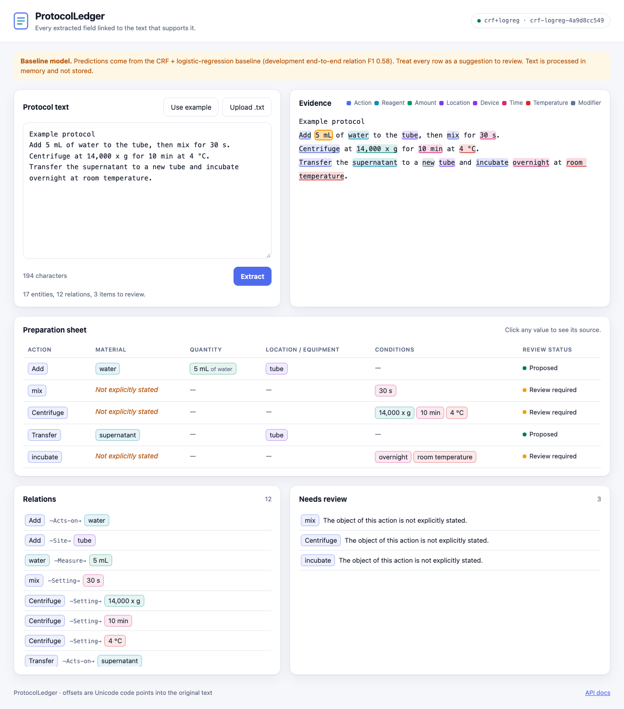
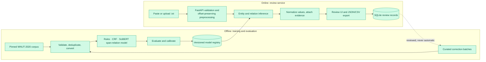

<p align="center">
  
</p>

<p align="center">
  <b>Turn a written lab protocol into a traceable preparation sheet, review uncertain interpretations, and export the corrected result.</b>
</p>

<p align="center">
  <a href="https://github.com/professor3333/ProtocolLedger/actions/workflows/ci.yml"></a>
  <a href="LICENSE"></a>
  
  <a href="https://github.com/astral-sh/ruff"></a>
  
  
</p>

<p align="center">
  <a href="#demo">Demo</a> ·
  <a href="#architecture">Architecture</a> ·
  <a href="#the-problem">The problem</a> ·
  <a href="#how-it-works">How it works</a> ·
  <a href="#results">Results</a> ·
  <a href="#quickstart">Quickstart</a> ·
  <a href="#data">Data</a> ·
  <a href="#deployment">Deployment</a> ·
  <a href="#limitations">Limitations</a> ·
  <a href="#documentation">Docs</a>
</p>

---

ProtocolLedger extracts **actions, materials, quantities, equipment and operating
conditions** from English lab protocols and arranges them into an editable preparation
sheet. Every field links back to the exact characters that support it, uncertain or
implicit interpretations go to a human reviewer, and the reviewed result exports as JSON
or CSV with full provenance.

At its core is a **span and directed-relation extraction model** trained and evaluated
here. It is compared against rule-based and classical baselines on a deduplicated split
of the WNUT-2020 Wet Lab Protocol corpus.

## Demo

<p align="center">
  
</p>

<sub>40-second recording of the real SciBERT model, with its output unedited until the reviewer
acts. It shows a correct extraction, a genuine attachment error, an unresolved case, the
corrections, then save and export. <a href="docs/assets/demo.mp4">MP4 version</a>.</sub>

<p align="center">
  
</p>

**Try it live:** **https://44.222.11.189.sslip.io** (always on until 2027-03-22, on a
small AWS VM), or run your own copy:
[](https://codespaces.new/professor3333/ProtocolLedger?quickstart=1)
<sub>(first start about 15 minutes, later starts under a minute;
[details](docs/deployment.md#live-demo-github-codespaces))</sub>

> [!NOTE]
> The banner shows the **intended** output for a worked example, not a model prediction.
> A user pilot and human gold labels for the new protocols.io sets were **not** done.

## Architecture



<sub>🟩 every component is built. Correction batches have been rehearsed but are not yet fed by real users.</sub>

## The problem

> *Add 5 mL of water to the tube, then mix for 30 s.*

Finding `5 mL`, `water` and `30 s` is only the start. A useful sheet has to know that
**5 mL measures the water**, **water is what gets added**, **the tube is the
destination**, **30 s belongs to mixing**, and that **the object being mixed is never
stated**. If a quantity is attached to the wrong material, the sheet is wrong even when
every entity is right. **Directed relation extraction** is therefore the core technical
challenge, and **reviewable evidence** is the core product requirement.

**Design principles**
- **Evidence first.** Every entity, relation and table cell carries `[start, end)` offsets
  into the original, unmodified text.
- **Never silently fill a gap.** *Not explicitly stated* is a separate state from *not
  required*. Implicit arguments become review items, not guesses.
- **Humans stay distinguishable.** Reviewer additions and edits are marked separately
  from model output, in the interface and in every export.
- **Honest evaluation.** Document-level deduplication, locked test sets, end-to-end
  scoring and bootstrap CIs. Targets were frozen before the test results were seen, and misses are reported.

## How it works

| System | Entities | Relations |
|---|---|---|
| Rules | unit regexes, action vocabulary, training-derived material dictionary | nearest compatible span in the clause |
| Traditional | linear-chain CRF with lexical and character features | logistic classifiers on types, distance, intervening words |
| **Neural** | span classification over a shared SciBERT encoder | span-pair classification, directed and multilabel |

The neural model (`src/protocolledger/neural/`) uses a SpERT-style design. It encodes
each step once, scores every span of up to 10 words (99.92% of training entities), and
classifies directed relations between the spans it keeps. Checkpoints are selected on
dev **end-to-end** relation F1. `bert-base-cased` is the control, so the value of
scientific pretraining is measured rather than assumed. Quantities such as `5–10 min`,
`14,000 x g` and `RT` are normalized by deterministic, tested rules
(`src/protocolledger/values.py`). Formats outside the supported set are left as written,
never guessed.

The review UI, API, saved reviews and input limits are described in
**[docs/review_interface.md](docs/review_interface.md)**. In short: reviews are
append-only SQLite revisions, protected by a token that is shown once. Protocol text is
stored only if the user opts in. Exports mark every item as model or human output.

## Results

**Locked test**: cleaned `test_data_2020` (111 protocols), evaluated **once** on
2026-10-11 ([report](reports/test/locked-test.md)). An end-to-end relation counts only
when its type, direction, both endpoint spans and both endpoint types are all correct.

| System | Entity F1 | Relation F1, gold entities | **Relation F1, end-to-end** | Quantity attachment |
|---|---:|---:|---:|---:|
| Rules | 0.647 [0.624, 0.668] | 0.575 | 0.292 [0.270, 0.317] | 0.441 |
| CRF + logistic regression | 0.703 [0.677, 0.727] | 0.768 | 0.504 [0.473, 0.536] | 0.629 |
| **SciBERT span-relation** | **0.766** [0.748, 0.784] | **0.787** | **0.580** [0.552, 0.606] | **0.699** |

| Frozen target ([docs/targets.md](docs/targets.md)) | Test result | Met |
|---|---|---|
| Strict entity micro-F1 ≥ 0.75 | 0.766 | yes |
| End-to-end relation micro-F1 ≥ 0.65 | 0.580 | **no** |
| ≥ 5 points above the traditional baseline | +7.6 points | yes |
| ≥ 95% relation precision at ≥ 30% coverage | 95% at 13.4% coverage | **no** |
| ≤ 5-point F1 loss under whitespace / Unicode perturbation | −0.01 points | yes |
| Optimized artifact ≤ 1-point F1 loss (dev) | ONNX INT8 −0.28 | yes |
| p95 ≤ 3 s, ≥ 99% success, ≤ 3 GB (container, 4 CPUs) | 2.40 s, 100%, 1.06 GB | yes |
| Normalization ≥ 98% on an independently checked set | no independent set | not evaluated |
| ≥ 25% faster sheet completion (user pilot) | pilot not run | not evaluated |

**Key findings**
- **SciBERT's lead grows on harder text.** It beats the traditional baseline by +7.6
  points end to end on test, and by +10.9 on recent protocols.io text (measured against
  machine labels, not human gold). Reagent recall on
  names unseen in training is 0.762 for SciBERT and 0.631 for the baseline.
- **Entity errors dominate.** For SciBERT, 27.7% of dev gold relations fail on an
  endpoint entity, while only 2.9% are genuine attachment errors.
- **Calibration transfers.** The dev-fitted isotonic calibrator lowers test expected
  calibration error from 0.172 to 0.021.
- **The annotations bound what is achievable.** Duplicate copies of the same protocol
  agree with each other at only relation F1 0.711.

Development-set tables, ablations, error analysis, the new-set results and serving
benchmarks are in **[docs/results.md](docs/results.md)**.

## Quickstart

Requires [uv](https://docs.astral.sh/uv/) and Python 3.12.

```bash
git clone https://github.com/professor3333/ProtocolLedger.git
cd ProtocolLedger
uv sync

# Data: fetch the pinned corpus (hash-verified), convert BRAT → JSONL, build frozen splits
uv run python scripts/acquire.py           # --verify re-checks an existing data/raw/
uv run python scripts/convert.py
uv run python scripts/build_splits.py

# Baselines (fit on train, select on dev) and scoring with the shared scorer
uv run python scripts/run_rules.py
uv run python scripts/run_traditional.py   # CRF + logistic regression, about 5 minutes on CPU
uv run python scripts/evaluate.py --split dev --pred predictions.jsonl --out report.json

# Serve the API and review interface (http://localhost:8000, API docs at /docs)
uv run python scripts/build_bundle.py      # refuses unless it reproduces the committed report
PROTOCOLLEDGER_BUNDLE=artifacts/bundles/crf-logreg-4a9d8cc549 PROTOCOLLEDGER_DB=data/reviews.db \
  uv run uvicorn --factory protocolledger.serve.app:create_app_from_env --port 8000
uv run python scripts/backup_reviews.py backup data/reviews.db backups/reviews.db

# Neural model (a GPU for real runs, CPU for smoke tests) and experiment tracking
uv sync --extra neural
uv run python scripts/train_neural.py configs/neural/scibert-lr5e-5.json --seed 13
uv run python scripts/log_reports_mlflow.py
MLFLOW_ALLOW_FILE_STORE=true uvx mlflow ui --backend-store-uri mlruns

# SciBERT image (CPU PyTorch + transformers)
docker build --build-arg EXTRAS=serve-neural -t protocolledger:neural .

# Tests (no network needed) and static checks; mypy needs every extra, as in CI
uv sync --all-extras
uv run pytest -m "not slow"
uv run ruff check && uv run ruff format --check && uv run mypy src/
```

<sub>These commands were run in order on a fresh clone (commit <code>61e0d0d</code>, 2026-10-17,
Apple M1). Every step succeeded, and the regenerated baseline reports matched the committed
ones in every metric. Retraining SciBERT needs a GPU and was not repeated in that check.</sub>

## Data

The corpus is the **WNUT-2020 Wet Lab Protocol corpus**
([jeniyat/WNUT_2020_NER](https://github.com/jeniyat/WNUT_2020_NER)), pinned at commit
[`9a02914`](https://github.com/jeniyat/WNUT_2020_NER/tree/9a02914e00f0a16c0c6820c4285dd72403a5a5a8),
with 18 entity types and 14 relation types. `data/manifests/acquisition.json` records the
SHA-256 of every file. Downloaded data is never committed.

| Split | Released docs | **Cleaned docs** | Entities | Relations |
|---|---:|---:|---:|---:|
| Train | 370 | **314** | 40,806 | 27,214 |
| Dev | 122 | **112** | 14,936 | 10,065 |
| Test (`test_data_2020`, locked) | 111 | **111** | 23,995 | 16,378 |

Copies and revisions of the same protocol, both exact and near-duplicate, are reduced to
one document, kept in the most protected split (test > dev > train). Data fixes go through a versioned
correction ledger, and nothing is dropped silently. For these reasons, cleaned scores are **not directly
comparable** with published WNUT-2020 results. Conversion, corrections, deduplication
and the residual-overlap audit are covered in the **[dataset card](docs/dataset_card.md)**.

Two small **new test sets** come from recent protocols.io protocols: a *later-domain* set
(38 protocols) and a *challenge* set (11 protocols, six hard phenomena). Both are split
by protocol, their test portions are locked, and they have machine labels only, with no human gold. See
**[docs/annotation_sets.md](docs/annotation_sets.md)**.

## Deployment

One Docker Compose stack on a single CPU host: **Caddy** (HTTPS), **the app** (a 134 MB
non-root image, read-only model bundles, an SQLite review volume) and **Prometheus**. A
release pins the image digest and the model-bundle hash together.
`scripts/release.py activate` smoke-tests a deploy and **restores the previous release
automatically** if it fails. `rollback` restores the previous image *and* bundle together.
Both paths were rehearsed with real containers. A version tag runs the release gates in
`configs/release_gates.json` and publishes the image to `ghcr.io`.

**Release [v1.1.0](https://github.com/professor3333/ProtocolLedger/releases/tag/v1.1.0)**
passed every gate. Its image is linux/amd64; on ARM, add `--platform linux/amd64` (it runs slowly under emulation):

```bash
docker pull ghcr.io/professor3333/protocolledger@sha256:f9d4e7d852e8f6d3010c754b182937b502e42f31bea367a6509ff36b6cdcedee
uv run python scripts/fetch_demo_bundle.py   # the pinned SciBERT bundle
docker run -p 127.0.0.1:8000:8000 -v "$PWD/artifacts/bundles:/models:ro" \
  -e PROTOCOLLEDGER_BUNDLE=/models/scibert-uniform-negatives-s21-7dc7a1893e \
  ghcr.io/professor3333/protocolledger@sha256:f9d4e7d852e8f6d3010c754b182937b502e42f31bea367a6509ff36b6cdcedee
```

The [deployment runbook](docs/deployment.md) covers releases, rollback, backups, monitoring,
the correction-batch lifecycle and both public demos.

## Limitations

- **Two frozen targets are missed** on the locked test: end-to-end relation F1 is 0.580
  against a target of 0.65, and 95% precision is reached only at 13.4% coverage against
  a target of 30%.
- **One source, one era.** All corpus protocols come from protocols.io and were annotated
  in or before 2020. Shared vendor templates remain after deduplication, so dev-based
  selection is somewhat optimistic.
- **No human gold for the new sets.** Their scores measure agreement with unreviewed
  machine labels, not accuracy.
- **No user pilot was run**, because no participants were available. There is no
  evidence that the tool saves time.
- **Not modelled:** implicit references, cross-step coreference, negation, alternatives
  and conditional instructions. Input is English plain text only.
- **Small-scale serving.** Latency was measured on an Apple M1 and on shared CI runners,
  where the 3 s gate has little margin. The public demo runs on a burstable VM and its
  reviews are not backed up.
- **Not for executing protocols**, or for judging whether one is complete, correct or
  safe. Every row is a suggestion for a person to review.

**What I'd do differently:** run the training-overlap audit *before* freezing the splits.
Spend the effort on entity boundaries rather than attachment, since that is where the
errors are. Build the blind annotation mode before the first annotation. Start the
work that depends on other people (the pilot and the human gold) in week one. Gate
latency on a fixed machine rather than on shared runners.

## Documentation

| Document | Contents |
|---|---|
| [Results](docs/results.md) | locked-test, new-set and dev results, ablations, error analysis, calibration, serving benchmarks |
| [Review interface and API](docs/review_interface.md) | UI behaviour, endpoints, saved reviews, input limits, quantity normalization |
| [Dataset card](docs/dataset_card.md) | sources, conversion, correction ledger, deduplication, splits |
| [New annotation sets](docs/annotation_sets.md) | protocols.io collection, machine labels, annotation workflow |
| [Model card](docs/model_card.md) | intended use, provenance, metrics, failure modes, release process |
| [Targets](docs/targets.md) | acceptance targets, frozen before the locked test |
| [Deployment runbook](docs/deployment.md) | releases, rollback, backups, monitoring, demos |
| [Annotation guidelines](docs/annotation_guidelines.md) | span and relation conventions for new gold |

```text
ProtocolLedger/
├── src/protocolledger/
│   ├── data/        # acquisition, BRAT parser, converter, corrections, dedup, splits, schema
│   ├── text/        # offset-preserving tokenizer, encoder-view normalization
│   ├── baselines/   # rules, CRF entities, logistic-regression relations
│   ├── neural/      # span + relation model, batching, training, prediction, tracking
│   ├── eval/        # shared scorer, error taxonomy, calibration
│   ├── serve/       # FastAPI app, bundles, review store, export, static UI
│   └── values.py    # deterministic quantity normalization
├── scripts/         # acquire, convert, train, evaluate, bundle, release, load test, …
├── configs/         # neural experiment configs, release gates
├── data/manifests/  # file hashes, conversion report, correction ledger, dedup, splits
├── reports/         # committed evaluation, error, calibration and performance reports
├── deploy/          # compose.yaml, Caddyfile, prometheus.yml
├── docs/            # cards, results, runbook, guidelines
└── tests/           # unit tests (no network)
```

## References

- J. Tabassum, W. Xu, A. Ritter. [WNUT-2020 Task 1 Overview: Extracting Entities and Relations from Wet Lab Protocols](https://aclanthology.org/2020.wnut-1.33/). W-NUT 2020.
- R. Tamari, F. Bai, A. Ritter, G. Stanovsky. [Process-Level Representation of Scientific Protocols with Interactive Annotation](https://aclanthology.org/2021.eacl-main.187/). EACL 2021.
- M. Eberts, A. Ulges. [Span-based Joint Entity and Relation Extraction with Transformer Pre-training](https://arxiv.org/abs/1909.07755). ECAI 2020.
- I. Beltagy, K. Lo, A. Cohan. [SciBERT: A Pretrained Language Model for Scientific Text](https://aclanthology.org/D19-1371/). EMNLP 2019.

## License

The code is released under the [MIT License](LICENSE). The WNUT-2020 corpus is
distributed by its authors under the MIT License. Its protocol texts come from
[protocols.io](https://www.protocols.io), where user content is published under
[CC BY](https://www.protocols.io/terms). Keep the corpus notice and per-protocol
attribution when redistributing protocol text.
