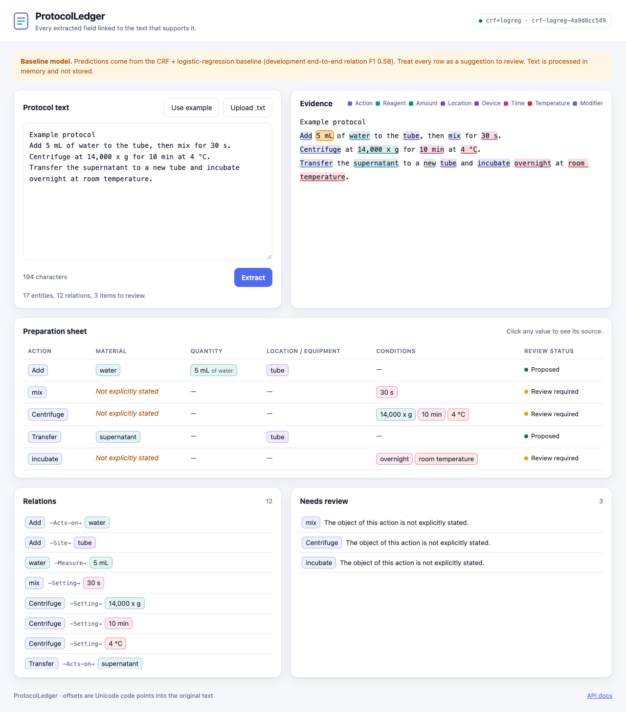

# Review interface and API

How the review page, the HTTP API, saved reviews and quantity normalization behave.
Back to the [README](../README.md).

  

a UTF-8 `.txt` protocol and the page shows:
- the text with every predicted span highlighted
- a preparation sheet in which each value links back to its source characters
- the directed relations
- a review queue

Actions whose object is not stated are shown as *Not explicitly stated*, marked
*Review required*, and never filled in.

**Reviewing.** Select a highlighted span to change its type, move its boundaries word by
word, or reject it. Select any other text to add a missing entity. Add or reject
relations; attaching a quantity to a different material or action replaces its old link.
Reviewer additions are dashed and badged *human*, edits are dotted, and rejections are
struck through but kept in the history. The sheet is recomputed by the server after
every edit, with the same validation that saving uses.

**Saving and exporting.** *Save review* stores a revision (the text only if you tick the
box) and shows a one-time access token. Later saves append revisions. JSON and CSV
exports carry the provenance. Extracted text is processed in memory and is not stored
unless you save a review and opt in.

| Endpoint | Purpose |
|---|---|
| `POST /v1/extract` | entities, relations, preparation-sheet rows, normalized quantities, review items, model version; offsets in Unicode code points |
| `GET /healthz` | process health |
| `GET /readyz` | model loaded; reports model version, bundle hash and dev scores |
| `POST /v1/preview` | validate an edited graph and recompute its sheet, review items and normalized values (stateless) |
| `POST /v1/reviews` | store an explicitly submitted review; returns an id and a one-time token; honors `Idempotency-Key` |
| `POST /v1/reviews/{id}/revisions` | append a corrected revision (token required; text must match the stored hash) |
| `GET /v1/reviews/{id}` | latest revision and full history (token required) |
| `POST /v1/reviews/{id}/export` | reviewed JSON or CSV with provenance; human additions marked |

**Saved reviews:**
- **Storage.** Reviews live in SQLite (WAL mode) and are append-only: every correction is
  a new revision, and database triggers refuse updates and deletes.
- **Text stays private by default.** Protocol text is stored only if the submitter opts
  in; otherwise only its SHA-256 is kept, and reopening or exporting requires the same
  text.
- **Access.** Each review has an unguessable id and a token shown once. Only the token's
  hash is stored. A wrong token and a missing review get the same 404.
- **Provenance.** Every entity and relation records whether it came from the model or a
  person. Model items are accepted, edited (with the original recorded) or rejected;
  human items are added.
- **Exports.** Exports carry the review id, revision, model version and text hash. The
  CSV neutralizes spreadsheet formulas without corrupting values such as `-80 °C`.
- **Backups.** `scripts/backup_reviews.py` takes consistent online backups and restores
  them after an integrity check.

Input is bounded: 256 KB per request, 20,000 characters, 400 lines. Invalid Unicode, NUL
characters and unknown fields are rejected, and error responses never echo submitted text.
The page sends a strict Content-Security-Policy and renders user text only as text.
Model bundles are verified by SHA-256 before anything is deserialized.

## Quantity normalization

Entity types are learned. Turning a quantity into a value is a fixed, tested rule
(`src/protocolledger/values.py`):
- `14,000 x g` → `14000 ×g`
- `5–10 min` → a range
- `~30 min` → 30 min with the qualifier "approximately"
- `-80ºC` → -80 °C
- `RT` → room temperature

Units are canonicalized case-sensitively (`mM` is not `mm`). The entity type resolves
ambiguous units: a bare `g` is grams for an Amount but ×g for a Speed.

Formats outside the supported set are **left as written, not guessed**. Examples are
`4 degrees` (Celsius or Fahrenheit) and `1 x 108`, which lost its superscript from
1×10⁸. The rules normalize 88% of training quantities. Accuracy on an independently
checked sample of supported formats is still to be measured.
